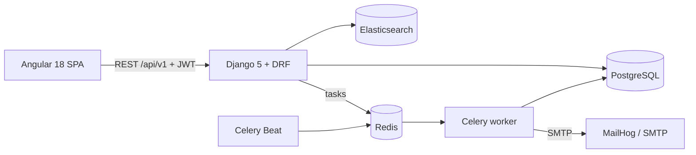

# BarrelGarden – e-commerce store (Django + Angular)

Full-stack online store for wooden hot tubs and garden spas, built as a **BSc engineering thesis** at
Bialystok University of Technology (*"Advanced online store with a customer communication module and product management"*, team of 2).

The backend (Django REST Framework) owns all business rules – prices, discounts, loyalty points and stock levels –
and the Angular SPA only displays them through a versioned REST API (`/api/v1/`).

## Features

- **Catalogue** – categories, products with variants, product quick view, server-side pagination
- **Search** – full-text search on Elasticsearch with a custom synonym list (`backend/elasticsearch/config/synonyms.txt`)
- **Cart & checkout** – cart drawer, order placement, order history in the user account
- **Invoices** – PDF invoices generated with WeasyPrint and e-mailed in the background by Celery
- **Loyalty programme** – points for every purchase, rewards exchanged for discount coupons
- **Customer support** – support tickets with message threads, plus a rule-based PL/EN chatbot
  (order status, delivery, returns, payments, product lookup)
- **Admin panel** – products, variants and attributes, categories, orders, loyalty rewards, support tickets,
  and sales statistics with charts (Chart.js)
- **Auth** – registration with e-mail verification, JWT (SimpleJWT + dj-rest-auth), Angular guards and an HTTP interceptor
- **i18n** – Polish and English for UI (ngx-translate) and product data (django-parler)
- **Background jobs** – Celery worker + Celery Beat on Redis (e-mails, invoices, hourly low-stock check)

## Architecture



## Tech stack

**Backend:** Python 3.12 · Django 5.2 · Django REST Framework · SimpleJWT · dj-rest-auth / allauth · django-parler ·
django-elasticsearch-dsl · Celery · Redis · WeasyPrint · drf-spectacular (OpenAPI)

**Frontend:** Angular 18 · TypeScript · RxJS · Tailwind CSS · ngx-translate · Chart.js

**Infrastructure & QA:** PostgreSQL 15 · Elasticsearch 8 · Docker Compose (8 services) · MailHog ·
pytest + pytest-django + pytest-cov (220+ backend tests) · Jasmine/Karma

## Quick start

Requirements: Docker Desktop and Git.

```bash
git clone https://github.com/Wojgos/Sklep-Balie.git
cd Sklep-Balie
cp .env.example .env
docker compose up --build
```

On the first start the backend runs migrations, seeds sample products and builds the search index.

| URL | What |
| --- | --- |
| http://localhost:4200 | Store (Angular) |
| http://localhost:8000/api/docs/ | Swagger UI |
| http://localhost:8000/admin/ | Django admin |
| http://localhost:8025 | MailHog – catches outgoing e-mails (verification, invoices) |

Create an admin account with:

```bash
docker compose exec backend python manage.py createsuperuser
```

## Tests

```bash
# backend (from the running container)
docker compose exec backend pytest --cov

# frontend
cd frontend
npm install
npm test
```

## Project structure

```text
backend/
  EStore/       settings, URLs, Celery app, permissions
  products/     catalogue, variants, Elasticsearch documents, low-stock task
  orders/       orders, PDF invoices, invoice e-mail task
  promotions/   loyalty rewards, redeemed rewards, discount coupons
  users/        registration, profiles, e-mail verification
  support/      support tickets
  chatbot/      rule-based PL/EN assistant
frontend/src/app/
  pages/        home, products, product details, checkout, account, loyalty, support, admin
  components/   header, cart drawer, search bar, product card, chatbot, notifications
  guards/  interceptors/  resolvers/  services/
```

## Authors

- **Wojciech Gosiewski** – [@Wojgos](https://github.com/Wojgos)
- **Arkadiusz Gnidziejko**
